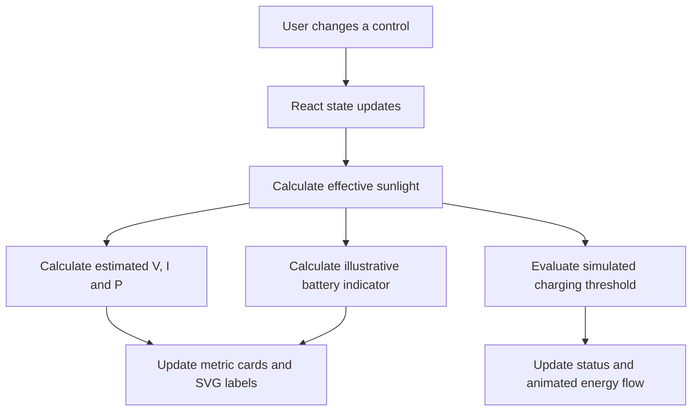
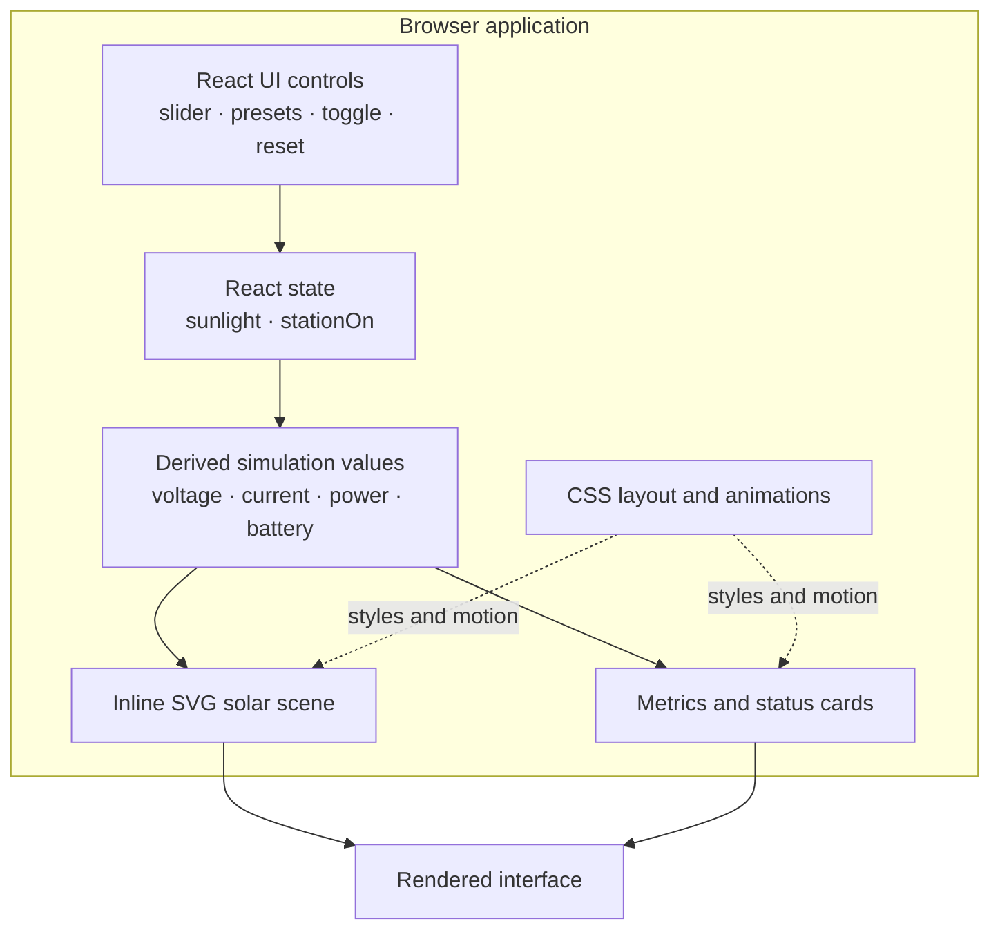

<!--
  SOLAR MOBILE CHARGER — GitHub README
  Premium visual documentation for the existing React + Vite simulation.
  The banner/typing graphics below are hosted SVGs; GitHub README does not run custom CSS/JS.
-->

  

  

  
  

  
  
  
  
  
  

  <strong>Understand the journey from sunlight to a mobile device—with a colourful, responsive and interactive engineering dashboard.</strong>

📚 Contents
- 🌞 Project Overview
- ✨ Features
- 🖥️ Live Demo and Visuals
- ⚙️ How It Works
- 🧮 Simulation Model and Equations
- 🧱 Application Architecture
- 🛠️ Technology Stack
- 💻 Run Locally
- 🎮 How to Use the Simulator
- 🧪 Testing and Validation
- 🚀 Deployment on Vercel
- 📁 Project Structure
- ⚠️ Scope, Assumptions and Limitations
- 🗺️ Future Enhancements
- 🤝 Contributing
- 📜 License
- 👨‍💻 Project Author
🌞 Project Overview
Solar Mobile Charger is a web-based engineering simulation that illustrates how available sunlight can influence the estimated electrical output in a conceptual solar-powered mobile charging station.
The interface presents a photovoltaic (PV) panel, connecting cables, a charge-controller illustration and a mobile device. An adjustable sunlight control updates the simulated voltage, current, power, battery indicator and charging-condition status. Animated light rays and cable-flow effects help explain the conceptual energy path.
[!IMPORTANT]
This project is a software simulation, not a physical charger or a measurement instrument. The displayed electrical values and battery percentage are illustrative calculations. The app does not read sensors, connect to a real solar panel, or charge a real phone.

🎯 Project objectives
- Demonstrate the basic photovoltaic energy-conversion concept.
- Show how changing a sunlight input affects estimated voltage, current and power in a simplified model.
- Visualise the conceptual path from the PV panel through a controller illustration to a mobile device.
- Provide an interactive way to explore low, medium and peak sunlight scenarios.
- Present engineering concepts in a colourful, responsive browser interface.
🌱 Why this project matters
Solar energy is an important renewable-energy resource. A visual simulator can help learners discuss PV generation, DC output, power calculations and the role of output regulation before working with real equipment. The model is intended for learning and demonstration, not for equipment sizing or electrical safety decisions.
✨ Features
Feature	What it does
☀️ Adjustable sunlight	Slider from 0% to 100% with one-point increments.
🎛️ Preset conditions	Quickly select Low Sun (20%), Medium (55%) or Peak Sun (100%).
⏻ Station toggle	Switch the simulation on or off. When off, effective sunlight and estimated output are set to zero.
🌄 Illustrated solar scene	SVG drawing of the sun, PV panel, wires, controller and mobile device.
✨ Animated energy path	CSS animations show sun-ray movement, energy-flow dashes and a pulsing charging symbol when applicable.
⚡ Electrical estimates	Live calculated voltage, current and power values.
🔋 Battery indicator	An illustrative percentage derived from the sunlight input; it is not a real battery-state measurement.
🚦 Charging-condition status	Shows whether the simulation's output threshold has been met.
↻ Reset control	Returns the station to its default state.
📱 Responsive layout	Dashboard layout adjusts for desktop, tablet and mobile screen widths.
♿ Reduced-motion support	CSS respects the user's reduced-motion preference.

🖥️ Live Demo and Visuals

  

Live application: solar-mobile-charger.vercel.app
Source repository: yagantieswarkurukunda6300-cell/solar-mobile-charger
🔄 The energy path at a glance

📸 Add an actual application screenshot
The live demo above is the current visual preview. To include a real repository screenshot in this section:
1. Open the live demo.
2. Set the sunlight slider to a scenario you want to show (for example, 80% or 100%).
3. Capture the browser window with the dashboard visible. Avoid including private browser tabs or personal information.
4. In the repository, create docs/images/ and upload the image as solar-station-dashboard.png.
5. Add this Markdown below and commit it with the image:

  

No screenshot file is linked here until a real screenshot is added to the repository; this avoids a broken image or a misleading mock screenshot.
⚙️ How It Works
The web interface is organised around four conceptual stages:
1. Sunlight input — the user selects an intensity from 0% to 100%.
2. PV generation illustration — the scene represents a photovoltaic panel converting available sunlight into DC electricity.
3. Controller illustration — a labelled controller represents the point where output regulation would be considered in a real system.
4. Mobile device illustration — the final visual stage shows the simulated charging condition.
The app uses React state to update the view whenever the sunlight slider, preset buttons, station toggle or reset button is used. The SVG scene and the values in the dashboard are rendered from the same calculated state, so they stay visually in sync.
State and update flow

🧮 Simulation Model and Equations
The implementation uses simplified equations to create responsive visual feedback. These equations are software assumptions, not specifications for a real solar panel or charger.
Let:
- sunlight = selected sunlight intensity, from 0 to 100.
- stationOn = whether the station toggle is on.
- effectiveSunlight = selected intensity while the station is on; otherwise zero.
1. Effective sunlight
effectiveSunlight = stationOn ? sunlight : 0;
2. Estimated voltage
voltage = (18 * effectiveSunlight) / 100;
3. Estimated current
current = (1.2 * effectiveSunlight) / 100;
4. Estimated power
power = voltage * current;
This follows the basic electrical relationship:
\[
P = V \times I
\]
where P is estimated power in watts, V is estimated voltage in volts, and I is estimated current in amperes.
5. Illustrative battery indicator
battery = clamp(Math.round(20 + effectiveSunlight * 0.7), 0, 100);
This number is a visual indicator derived from the input. It does not represent measured battery state of charge, and it does not accumulate energy over elapsed time.
6. Simulated charging condition
charging = stationOn && effectiveSunlight >= 15;
The interface reports charging conditions when the station is on and the effective sunlight value reaches the app's threshold of 15. This status is a UI rule, not proof that a physical mobile device would charge.
Example default state
The app starts with the station on and sunlight at 80%. Under the current formulas, the display is expected to show approximately:
Display	Illustrative result
Voltage	14.4 V
Current	0.96 A
Power	13.8 W (rounded for display)
Battery indicator	76%
Condition label	Peak sunlight

These are outputs of the code's model, not measured electrical results.
🧱 Application Architecture

Architectural notes
- Frontend-only: the current app has no backend API, database, authentication system or hardware communications layer.
- State-driven: calculations are derived directly from React state in src/App.jsx.
- SVG illustration: the current solar scene is drawn with inline SVG and styled with CSS. It should not be described as a physical or sensor-connected 3D system.
- Responsive styling: src/App.css contains desktop, tablet and mobile layout rules, animation definitions and reduced-motion handling.
- Entry point: src/main.jsx mounts the React app and imports the global stylesheet.
🛠️ Technology Stack
Technology	Role in this repository
React 19	Component rendering and interactive state.
Vite 8	Local development server and production build tooling.
JavaScript (ES modules)	Simulation formulas and interface logic.
CSS	Styling, responsive layouts, visual transitions and animations.
Inline SVG	Scalable illustration of the solar charging scene.
Oxlint	Configured lint command.
npm	Dependency installation and project scripts.

The repository's package manifest also includes three, @react-three/fiber and @react-three/drei dependencies. The current main scene described above is implemented in SVG/CSS; this README does not claim that the current screen is a WebGL-rendered 3D scene.
💻 Run Locally
Prerequisites
- Node.js compatible with Vite 8: Node.js 20.19+ or 22.12+.
- npm, which is distributed with Node.js.
- Git, if you want to clone the repository.
- A modern web browser.
Check the installed versions:
node -v
npm -v
Step 1 — Clone the repository
git clone https://github.com/yagantieswarkurukunda6300-cell/solar-mobile-charger.git
Step 2 — Open the project directory
cd solar-mobile-charger
Step 3 — Install dependencies
npm install
This installs the packages listed in package.json and resolves versions using package-lock.json.
Step 4 — Start the development server
npm run dev
Vite prints a local URL in the terminal, usually http://localhost:5173/. Open the exact URL shown in your terminal. Leave the terminal running while you use the app.
Step 5 — Create a production build
Stop the development server if needed, then run:
npm run build
A successful build creates the production output in the dist/ directory.
Step 6 — Preview the production build locally (optional)
npm run preview
Use the local preview URL printed by Vite to inspect the built version.
Available npm scripts
Command	Purpose
npm run dev	Starts the Vite development server.
npm run build	Builds the app for production.
npm run preview	Serves the local production build for preview.
npm run lint	Runs Oxlint with the repository's current configuration.

🎮 How to Use the Simulator
1. Open the live simulator or run it locally.
2. Start with the station on. The initial sunlight control is set to 80%.
3. Move the Sunlight Intensity slider between 0% and 100%.
4. Watch the voltage, current, power and battery indicator update.
5. Try Low Sun, Medium and Peak Sun to compare the model's responses.
6. Switch the station off to see the simulated output drop to zero; switch it on again to continue exploring.
7. Select Reset simulation to return to the default state.
What to observe
- At zero effective sunlight, the estimated electrical output is zero.
- As the slider increases, estimated voltage and current increase linearly under the current formulas.
- Estimated power changes according to voltage × current.
- The charging-condition message depends on the built-in threshold, rather than a physical charging test.
- The scene's movement and glow effects are visual feedback, not a measurement of energy transfer.
🧪 Testing and Validation
Use this checklist when verifying a local change. It is a manual validation plan, not a claim that every check has already been executed.
Check	Action	Expected behaviour
Development startup	Run npm run dev.	Vite starts and the app opens in a browser.
Production build	Run npm run build.	Build completes and dist/ is generated.
Lint	Run npm run lint.	Oxlint reports any findings using the current config.
Minimum sunlight	Set the slider to 0%.	Effective sunlight, voltage, current and power become zero; status indicates no/low output.
Presets	Select each sunlight preset.	Slider and displayed estimates update to the selected input.
Station off	Switch the station off.	Effective sunlight and estimated output become zero, with the off overlay visible.
Reset	Change the input, then reset.	Station returns to on and sunlight returns to 80%.
Responsive layout	Test desktop and narrow/mobile widths.	Dashboard sections reflow without requiring desktop width.
Motion preference	Enable reduced motion in OS/browser settings.	CSS animations and transitions are reduced.

Engineering validation note: the app does not read hardware sensors, so its software calculations cannot validate a real panel's output or confirm charging compatibility. Hardware testing would require a separately designed and safely tested electrical prototype.
🚀 Deployment on Vercel
The project has a live deployment at solar-mobile-charger.vercel.app. To connect or redeploy the repository:
Dashboard method
1. Push the project to GitHub.
2. Sign in to Vercel.
3. Choose Add New → Project and import yagantieswarkurukunda6300-cell/solar-mobile-charger.
4. Confirm the project root is the repository root.
5. Use the following Vite build settings if Vercel does not detect them automatically:
   Setting	Value
   Framework preset	Vite
   Install command	npm install
   Build command	npm run build
   Output directory	dist
6. Select Deploy.
7. Open the deployment URL and test the slider, presets, station toggle and reset button.
Publish updates later
After changing code and confirming it works locally:
git add README.md
git commit -m "Upgrade Solar Mobile Charger README"
git push origin main
If the repository is connected to Vercel with Git integration, a push to the configured production branch can trigger a deployment. Check the Vercel deployment status before treating the new version as live.
📁 Project Structure
solar-mobile-charger/
├── public/              # Static public assets
├── src/
│   ├── App.jsx          # React UI, SVG solar scene and simulation calculations
│   ├── App.css          # Main dashboard styling, animations and responsive rules
│   ├── index.css        # Global/base styles
│   └── main.jsx         # React application entry point
├── .gitignore
├── .oxlintrc.json       # Oxlint configuration
├── index.html           # Vite HTML entry point
├── package.json         # Scripts and dependencies
├── package-lock.json    # npm dependency lockfile
├── vite.config.js       # Vite configuration
└── README.md            # Project documentation
⚠️ Scope, Assumptions and Limitations
- Simulation only: the UI does not control or connect to a physical solar charger, controller, battery or phone.
- Illustrative parameters: 18 in the voltage formula and 1.2 in the current formula are model coefficients, not confirmed panel ratings.
- No physical measurements: voltage, current and power are calculated in browser code; no sensor readings are collected.
- Battery display is illustrative: its percentage is directly mapped from effective sunlight; it does not model real battery capacity, charge rate, ageing or state of charge.
- Simplified charging status: the threshold only selects the app's display state. It does not check a phone's USB input requirements or battery-charging protocol.
- No backend or persistence: the current state is held in the running React app and is reset when the reset control is used or the app is reloaded.
- Not a design specification: do not use these formulas to select components, determine real output ratings or design electrical protection.
Any future physical prototype should be developed separately with appropriately rated charging and regulation circuitry, verified component specifications, and proper electrical safety checks.
🗺️ Future Enhancements
Possible directions for future versions—not claimed as implemented today:
- Add a real-time chart of simulated voltage, current and power against sunlight input.
- Add user-selectable theoretical panel ratings and explain the assumptions behind each model.
- Add a comparison mode for low, medium and peak sunlight.
- Add an accessible data table explaining the live calculations.
- Capture and store genuine application screenshots in docs/images/.
- Add an optional educational section explaining PV cells, DC output regulation and charging standards.
- If physical hardware is ever added, design a separate hardware interface and clearly distinguish measured values from simulated values.
🤝 Contributing
Ideas and improvements that make the simulator more accurate, understandable, accessible and responsive are welcome.
1. Fork the repository.
2. Create a focused branch for your change.
3. Keep changes scoped to the improvement you are making.
4. Run npm run lint and npm run build.
5. Test the relevant controls at desktop and mobile widths.
6. Open a pull request describing the change and how it was checked.
Please label new formulas and readings clearly as simulated unless they are connected to and verified by real measurement hardware.
📜 License
A LICENSE file was not present in the repository when this README was prepared. Until a license is added, do not assume that public availability grants permission to reuse, modify or redistribute this project. Add a license file if you want to specify reuse terms.
👨‍💻 Project Author
Kurukunda Yaganti Eswar
Electrical Engineering · Renewable Energy · Interactive Engineering Simulations

  
  

  <strong>☀️ Learn from sunlight. Think in systems. Build with purpose. ⚡</strong>

  

