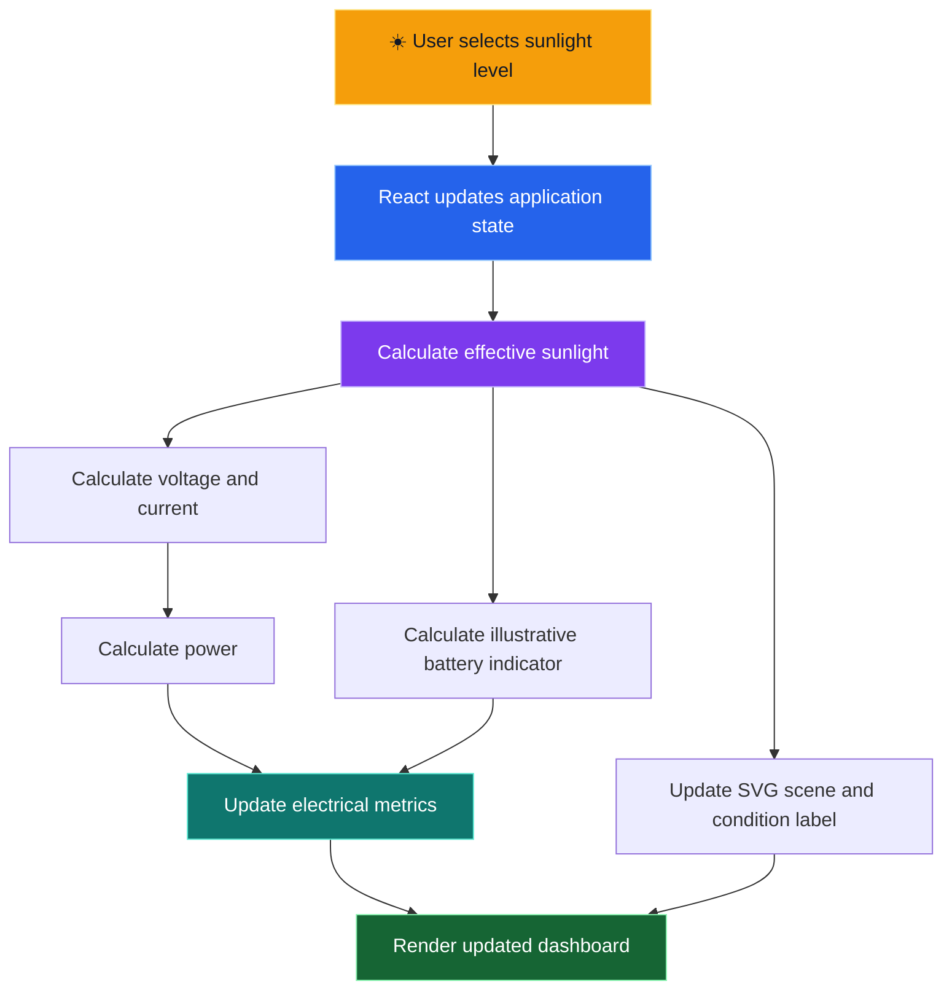
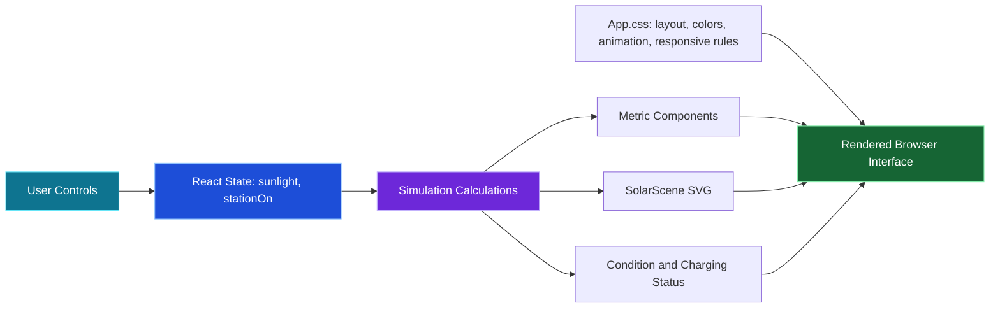

  

  

  
  

  
  
  
  
  

  <strong>☀️ SUNLIGHT &nbsp; → &nbsp; ⚡ PV PANEL &nbsp; → &nbsp; 🔌 CONTROLLER CONCEPT &nbsp; → &nbsp; 📱 MOBILE DEVICE</strong>

📑 TABLE OF CONTENTS
- 🌞 Project Overview
- 🎯 Problem Statement
- 💡 Objectives
- ✨ Features
- 🖥️ Interface Guide
- 🔄 Working Principle
- 🏗️ Software Architecture
- ⚡ Simulation Equations
- 🧮 Example Calculations
- 🎮 How to Use the Application
- 🛠️ Technology Stack
- 📂 Project Structure
- 💻 Installation and Setup
- 🧪 Testing Checklist
- 📸 Screenshots
- 🚀 Deployment with Vercel
- 🔍 Troubleshooting
- ⚠️ Engineering Limitations
- 🌱 Future Improvements
- 📚 Learning Outcomes and Viva Questions
- 👨‍💻 Developer
🌞 PROJECT OVERVIEW
Solar Mobile Charger — Interactive Solar Charging Station Simulator is a React-based educational web application that visually explains the concept of using solar energy for mobile charging.
The dashboard represents an outdoor solar charging station with a photovoltaic (PV) panel, sunlight rays, connecting cables, a controller illustration, and a mobile device. Users can adjust the simulated sunlight intensity and immediately observe changes in calculated voltage, current, power, the illustrative battery indicator, and the charging-status message.
The project brings together electrical engineering concepts and frontend development. React state controls the simulation, JavaScript calculates the displayed readings, SVG draws the solar environment, and CSS provides the dashboard layout, visual effects, animations, and responsive styling.
Project scope: This is a software simulation. It does not connect to a physical solar panel, read real electrical sensors, or charge an actual mobile phone.

  

🌍 Why This Project?
Solar energy is a renewable source of energy that can be converted to electricity by photovoltaic cells. Understanding the path from sunlight to useful electrical output is an important foundation for students exploring solar power, DC circuits, power calculations, and energy systems.
Static diagrams explain components, but they do not always make it easy to see how a changing input affects displayed output. This simulation lets the user experiment with a sunlight input and observe the model's response in one interface.
🎯 PROBLEM STATEMENT
Students may learn voltage, current, power, and photovoltaic conversion as separate topics, without a clear visual connection between them. Physical solar equipment may also be unavailable during early learning or demonstrations.
This project provides an interactive, browser-based model to help learners:
- Explore a conceptual solar mobile-charging setup.
- Change a simulated sunlight input from 0% to 100%.
- See calculated electrical estimates update instantly.
- Understand the software relationship between input state, equations, and interface output.
The goal is educational visualization, not real-world electrical performance prediction.
💡 OBJECTIVES
No.	Objective	Explanation
01	Visualize solar charging	Represent a PV panel, controller concept, cables, and mobile device.
02	Simulate sunlight changes	Allow the user to select a sunlight percentage.
03	Demonstrate DC quantities	Display estimated voltage, current, and power.
04	Represent operating status	Use a defined software threshold to update the charging-status message.
05	Make the concept interactive	Connect controls with React state and dynamic SVG rendering.
06	Support engineering learning	Link the visual model to basic electrical calculations.

✨ FEATURES

  
  
  
  

1. ☀️ Adjustable Sunlight Intensity
The slider accepts whole-number values from 0% to 100%. As the value changes, React recalculates the estimated output and updates the scene and metrics.
Three preset buttons are included:
- Low sun — 20%
- Medium — 55%
- Peak sun — 100%
Selecting a preset sets the selected sunlight value and switches the station ON.
2. 🔌 Station ON/OFF Toggle
The station toggle enables or disables the simulation output. When the station is OFF, the effective sunlight used by the equations becomes zero. The estimated voltage, current, and power therefore become zero, the scene receives a disabled appearance, and an overlay explains that the station is switched off.
The selected slider value is retained while the station is OFF, but the slider is disabled. Switching the station back ON resumes the selected setting.
3. ⚡ Electrical Output Dashboard
The dashboard displays four indicators:
Reading	Unit	Meaning in this application
Voltage	V	Calculated DC-voltage estimate
Current	A	Calculated output-current estimate
Power	W	Voltage multiplied by current
Battery	%	Illustrative indicator calculated from the effective sunlight input

These are model outputs, not live measurements from hardware.
4. 🌄 Interactive SVG Solar Scene
The SolarScene component draws the station with SVG. It includes a sky and ground, a sun with rays, a photovoltaic panel with cell lines, panel support legs, wiring, a controller illustration, a mobile device, and component labels.
The scene receives the effective sunlight, charging condition, voltage, current, power, and battery indicator through React props. Relevant visual elements update when the simulation state changes.
5. 🔄 Four-Stage Energy Path
The interface presents this conceptual sequence:
Sunlight → PV Panel → Controller → Mobile Device
Stages are visually highlighted according to the simulation state. This is an explanatory representation of the intended system, not a live electrical circuit diagram.
6. 🟢 Condition and Charging Status
The app labels the sunlight condition as No output, Low sunlight, Good sunlight, or Peak sunlight, based on the effective sunlight percentage. A separate software rule determines whether the message reads Charging conditions detected or Insufficient output.
7. ↻ Reset Simulation
The reset button restores the initial application state: 80% selected sunlight and station ON. All estimates are recalculated from that state.
8. 📱 Responsive Dashboard and Visual Styling
The CSS stylesheet defines a dark engineering-dashboard theme with orange and green accents, gradient surfaces, metric cards, focus states, hover transitions, animated sunlight rays, a breathing sun effect, and a moving simulated cable-flow effect. Responsive CSS rules adapt the layout to different screen widths, and reduced-motion handling is included in the stylesheet.
🖥️ INTERFACE GUIDE
Interface area	What it does
Header	Displays SolarStation branding and the station toggle.
Hero section	Introduces the interactive engineering simulation.
Live environment	Shows the illustrated PV panel, sun, wires, controller, and phone.
Scene legend	Identifies the sunlight and cable/output visual indicators.
Energy conversion	Shows the four conceptual stages.
Control center	Lets users move the slider, select presets, and reset the simulation.
Electrical output	Displays voltage, current, power, and battery-indicator values.
Status panel	Communicates whether the defined simulation threshold is satisfied.
Project overview	Summarizes the model's input, conversion concept, power path, and monitoring.
Footer	Identifies the application as an engineering simulator.

🔄 WORKING PRINCIPLE
The application demonstrates the following conceptual workflow:

Stage 1 — Sunlight input
The user chooses a sunlight percentage with the slider or a preset. The station toggle determines whether that input contributes to the model.
Stage 2 — Effective sunlight
If the station is ON, the effective sunlight equals the selected slider value. If the station is OFF, effective sunlight is set to zero for the calculations.
Stage 3 — Electrical estimates
JavaScript calculates voltage and current using the configured linear formulas. Power is then calculated by multiplying voltage by current.
Stage 4 — Status and visualization
React passes the calculated values into dashboard components and the SVG scene. The status message, visual intensity, indicator lights, and simulated cable animation respond to the resulting state.
🏗️ SOFTWARE ARCHITECTURE

Main components
- App — maintains sunlight and stationOn, calculates the output values, defines the preset and reset behavior, and renders the main interface.
- SolarScene — renders the responsive SVG solar environment. It receives the current model values as props.
- Metric — displays one measurement card with a label, value, unit, color, and short explanation.
- App.css — controls the visual design, dashboard layout, animations, control styling, focus states, and responsive behavior.
- main.jsx — entry point that mounts the React application.
- Vite — serves the application during development and produces the production bundle.
The current simulation logic runs in the browser. A backend, database, sensor service, or AI model is not required for the behavior documented here.
⚡ SIMULATION EQUATIONS
The numbers shown in the dashboard are generated by simple software assumptions. Let:
- S = effective sunlight percentage (0 to 100)
- V = estimated voltage in volts
- I = estimated current in amperes
- P = estimated power in watts
- B = illustrative battery indicator in percent
1. Effective sunlight
const effectiveSunlight = stationOn ? sunlight : 0;
The selected value is used while the station is ON; otherwise, the effective value is zero.
2. Voltage
\[
V = \frac{18 \times S}{100}
\]
The model maps 0–100% effective sunlight to 0–18 V.
3. Current
\[
I = \frac{1.2 \times S}{100}
\]
The model maps 0–100% effective sunlight to 0–1.2 A.
4. Power
\[
P = V \times I
\]
Substituting the two equations:
\[
P = 21.6\left(\frac{S}{100}\right)^2
\]
Since voltage and current are each directly proportional to the selected sunlight percentage in this simplified model, calculated power is proportional to the square of that percentage.
5. Illustrative battery indicator
const battery = clamp(Math.round(20 + effectiveSunlight * 0.7), 0, 100);
The indicator is calculated from the effective sunlight percentage and clamped to 0–100%. When the station is OFF, the formula produces 20%, not 0%. This is only a visual indicator; it is not a real battery state-of-charge calculation.
6. Charging-status rule
const charging = stationOn && effectiveSunlight >= 15;
The interface reports Charging conditions detected when the station is ON and the effective sunlight is at least 15%. Otherwise, it reports Insufficient output.
The condition labels use separate ranges:
- No output: effective sunlight is 0%.
- Low sunlight: effective sunlight is above 0% and below 30%.
- Good sunlight: effective sunlight is from 30% to below 70%.
- Peak sunlight: effective sunlight is 70% or higher.
These names and thresholds are application rules. They do not represent validated real-world irradiance categories or determine whether a physical phone can safely charge.
🧮 EXAMPLE CALCULATIONS
The table below applies the implemented formulas. Values are rounded to match the dashboard display.
Selected sunlight	Station	Voltage	Current	Power	Battery indicator	Condition label
0%	ON	0.0 V	0.00 A	0.0 W	20%	No output
20%	ON	3.6 V	0.24 A	0.9 W	34%	Low sunlight
55%	ON	9.9 V	0.66 A	6.5 W	59%	Good sunlight
80%	ON	14.4 V	0.96 A	13.8 W	76%	Peak sunlight
100%	ON	18.0 V	1.20 A	21.6 W	90%	Peak sunlight
80% selected	OFF	0.0 V	0.00 A	0.0 W	20%	No output

Example at 80%:
\[
V = 18 \times 0.80 = 14.4\,V
\]
\[
I = 1.2 \times 0.80 = 0.96\,A
\]
\[
P = 14.4 \times 0.96 = 13.824\,W \approx 13.8\,W
\]
The battery indicator is round(20 + 0.7 × 80) = 76%.
Engineering note: 18 V and 1.2 A are constants chosen by the software model, not measured or verified specifications for a physical panel. Do not use these examples to design or connect real charging hardware.

🎮 HOW TO USE THE APPLICATION
1. Open the Solar Mobile Charger live demo.
2. Observe the initial state: sunlight is set to 80% and the station is ON.
3. Move the sunlight slider from 0% to 100% and watch the estimated readings and SVG scene update.
4. Select Low sun, Medium, or Peak sun to apply the 20%, 55%, or 100% presets.
5. Switch the station OFF. The effective sunlight and calculated voltage/current/power become zero, the slider is disabled, and the scene displays an OFF overlay.
6. Switch the station ON again to resume calculations using the selected sunlight value.
7. Observe the condition label and status message as the input changes.
8. Press Reset simulation to return to 80% sunlight with the station ON.
🛠️ TECHNOLOGY STACK
Technology	Role
React 19	Component-based UI and state-driven rendering
JavaScript / ES modules	Event handling and simulation calculations
Vite 8.3	Local development server and production build
CSS	Layout, dashboard styling, animation, responsive behavior, and visual states
SVG	Solar panel, outdoor scene, controller, cables, mobile device, and labels
npm	Dependency installation and project scripts
Git and GitHub	Version control and source-code hosting
Vercel	Hosting the live frontend application

The repository also declares Three.js-related dependencies in package.json. The currently documented dashboard and scene in App.jsx are rendered with React and SVG; this README does not claim that the visible scene is a Three.js 3D scene.
📂 PROJECT STRUCTURE
solar-mobile-charger/
├── public/                 # Public static assets
├── src/
│   ├── App.jsx             # Main UI, formulas, controls, and SVG scene
│   ├── App.css             # Layout, theme, animations, and responsive styles
│   └── main.jsx            # React entry point
├── index.html              # HTML entry page
├── package.json            # Dependencies and npm scripts
├── package-lock.json       # Locked dependency versions
├── vite.config.js          # Vite configuration
├── .oxlintrc.json          # Oxlint configuration
├── .gitignore              # Git-excluded files
└── README.md               # Project documentation
💻 INSTALLATION AND SETUP
Prerequisites
Install Node.js with a version supported by the Vite version used in this repository, along with npm and Git. A code editor such as Visual Studio Code is recommended.
Verify the installations:
node -v
npm -v
git --version
Step 1 — Clone the repository
git clone https://github.com/yagantieswarkurukunda6300-cell/solar-mobile-charger.git
Step 2 — Open the project folder
cd solar-mobile-charger
Step 3 — Install dependencies
npm install
This installs the packages declared in package.json and resolves dependencies for the project.
Step 4 — Start the development server
npm run dev
Vite prints a local development URL in the terminal. Open that URL in your browser. Keep the terminal running while you use the development server.
Step 5 — Run the linter
npm run lint
This runs the repository's configured Oxlint command.
Step 6 — Build the production version
npm run build
Vite writes the production bundle to the dist/ directory.
Step 7 — Preview the production build
npm run preview
Open the preview URL printed in the terminal to inspect the built frontend.
Available npm scripts
Command	Purpose
npm run dev	Start the Vite development server
npm run lint	Run Oxlint
npm run build	Generate the production build
npm run preview	Preview the production build locally

🧪 TESTING CHECKLIST
Use this manual checklist when verifying the application after a change.
Functional checks
- [ ] The page opens without a blank screen.
- [ ] The initial sunlight value is 80%.
- [ ] The station starts ON.
- [ ] The slider accepts values from 0 through 100 in single-percentage steps.
- [ ] Low sun selects 20% and switches the station ON.
- [ ] Medium selects 55% and switches the station ON.
- [ ] Peak sun selects 100% and switches the station ON.
- [ ] Switching OFF makes calculated voltage, current, and power zero.
- [ ] The slider is disabled while the station is OFF.
- [ ] Switching ON resumes the selected sunlight input.
- [ ] Voltage follows 18 × effectiveSunlight / 100.
- [ ] Current follows 1.2 × effectiveSunlight / 100.
- [ ] Power equals voltage multiplied by current.
- [ ] The illustrative battery indicator follows its formula and stays within 0–100%.
- [ ] The charging message follows the 15% threshold and station state.
- [ ] Reset restores 80% sunlight and station ON.
- [ ] The SVG scene and metrics update when the input changes.
Build and responsive checks
- [ ] npm run lint completes, or reports issues that have been reviewed.
- [ ] npm run build completes successfully.
- [ ] The production preview loads.
- [ ] Layout remains usable on desktop, tablet, and mobile widths.
- [ ] Text, buttons, and metric values remain readable at smaller widths.
- [ ] Keyboard focus is visible on interactive controls.
A successful build verifies that Vite can create a production bundle. It does not, by itself, prove every interactive behavior has been tested.
📸 SCREENSHOTS
A real screenshot of the application makes the repository easier to understand. Capture the deployed or locally running interface rather than substituting an unrelated illustration.
Recommended screenshots:
1. Full dashboard: solar scene, controls, and all output cards.
2. Peak sunlight: station ON with the slider at 100%.
3. Station OFF: disabled scene overlay and zero-output readings.
Add your screenshots
1. Open the application locally or at the live demo.
2. Use Windows Snipping Tool or another screenshot utility to capture the actual interface.
3. Save your image in the repository, for example as docs/images/solar-mobile-charger-dashboard.png.
4. Add the image to this README with the following Markdown after the file exists:

  

The README currently uses animated banner art, badges, and Mermaid diagrams. A real UI screenshot is intentionally not fabricated.
🚀 DEPLOYMENT WITH VERCEL
The project is a Vite frontend application and can be deployed as a static build.
Step 1 — Push the latest code to GitHub
Ensure that the intended files are committed and pushed to the main branch of this repository.
Step 2 — Open Vercel
Go to Vercel Dashboard and choose the option to add or import a project.
Step 3 — Import the repository
Select:
yagantieswarkurukunda6300-cell/solar-mobile-charger
If the repository is already connected to Vercel, open the existing project instead of creating another one.
Step 4 — Confirm build settings
Use the detected Vite settings, or confirm the following values:
Setting	Value
Framework preset	Vite
Install command	npm install
Build command	npm run build
Output directory	dist

The current documented simulation does not require a backend service or environment variables.
Step 5 — Deploy and verify
Start the deployment and review its build logs. After it is marked successful, open the deployed website and test the slider, presets, station toggle, estimated readings, charging status, and reset button.

  

🔍 TROUBLESHOOTING
npm is not recognized
Install Node.js and make sure its installation directory is available in your terminal's PATH. Restart the terminal, then run node -v and npm -v again.
Dependency installation fails
Make sure the terminal is inside the solar-mobile-charger folder and package.json exists. Check your Node.js version against the requirements of the installed Vite release, then retry npm install.
The local port is busy
Vite may select another available port if its default port is already in use. Open the exact local URL printed in the terminal, rather than assuming a fixed port number.
The build fails
Run these commands separately and read the first relevant error:
npm run lint
npm run build
Correct the underlying error before deploying. Do not ignore failed builds.
Changes do not appear on the deployed website
1. Save the files you edited.
2. Confirm that you are in the correct repository and branch.
3. Commit and push the intended changes.
4. Check the latest Vercel deployment and its build logs.
5. Refresh the live page after a successful deployment.
⚠️ ENGINEERING LIMITATIONS
Accuracy about the model is part of the project documentation.
Implemented in software
- Adjustable sunlight input.
- Station ON/OFF behavior.
- Formula-based voltage, current, and power estimates.
- An illustrative battery indicator.
- A software charging threshold.
- A responsive SVG illustration of the solar charging concept.
- Dynamic status labels, dashboard metrics, and visual effects.
Not implemented as physical hardware
- A real photovoltaic panel connected to the application.
- Irradiance, voltage, or current sensors.
- A working charge-controller circuit.
- A regulated USB charging output.
- Measurement of a real phone battery's state of charge.
- Actual phone charging or battery communication.
- Hardware protection or electrical safety validation.
- A data-logging backend or database.
Why this distinction matters
Real photovoltaic output depends on panel specifications, irradiance, temperature, electrical operating point, wiring losses, and the connected load. A real mobile charging system also needs a suitable power-conversion and charging design compatible with its battery and device.
The current equations do not model those physical effects. Their constants are illustrative software assumptions for learning how the interface reacts to its input. Do not use the displayed figures as hardware specifications or as instructions for connecting a real phone or battery.
🌱 FUTURE IMPROVEMENTS
The following are ideas for future versions; they are not claims about existing functionality.
Hardware and measurement
- Integrate a photovoltaic panel with an appropriately designed and verified power stage.
- Add correctly rated voltage and current sensing.
- Add a suitable charging controller and required electrical protections.
- Compare real measurements with simulated estimates.
Monitoring and visualization
- Plot measurements over time once real or explicitly simulated time-series data exists.
- Add an exportable history for collected readings.
- Provide additional sunlight scenarios for learning.
- Include verified screenshots and a short demo video in the repository.
User experience
- Further improve keyboard navigation and accessibility.
- Add explanatory tooltips for voltage, current, and power.
- Add a separate view for comparing different model inputs.
Any physical hardware extension must be designed and validated against the relevant electrical and battery-safety requirements before real use.
📚 LEARNING OUTCOMES AND VIVA QUESTIONS
Learning outcomes
By exploring the application and its source code, learners can review:
- Basic renewable-energy and photovoltaic concepts.
- DC voltage, current, and power relationships.
- How a simplified mathematical model turns an input into displayed output.
- React state and event handling.
- Component reuse through the Metric component.
- Rendering an SVG scene from React props.
- CSS animation, responsive layout, and focus states.
- Development and production workflows using Vite.
- Git-based version control and GitHub hosting.
- Frontend deployment using Vercel.
- The difference between a software simulation and a measured physical system.
Suggested viva questions
1. What is the objective of Solar Mobile Charger?
To demonstrate the concept of a solar-powered mobile charging station through an interactive browser simulation.
2. What is a photovoltaic panel?
A panel containing photovoltaic cells that convert suitable incident light into electrical energy.
3. What is the formula used for power in this project?
P = V × I, using the voltage and current estimates generated by the software model.
4. Does the application measure real voltage and current?
No. Both values are calculated in JavaScript; no physical sensors are connected.
5. Why does the model's power change quadratically with sunlight?
The model makes both voltage and current proportional to the sunlight percentage. Multiplying those values makes power proportional to the square of that percentage.
6. Does the battery indicator measure a real phone battery?
No. It is an illustrative percentage calculated from the effective sunlight input.
7. What does React do in this application?
It manages the interface components and state, then renders updated readings and scene elements after user interaction.
8. What is Vite used for?
It runs the development server and builds the deployable frontend files.
9. What happens when the station is turned OFF?
The effective sunlight becomes zero for the calculations, so estimated voltage, current, and power become zero. The selected slider value is retained but its control is disabled.
10. Is this a complete physical solar charger?
No. It is a visual and mathematical frontend simulation of the concept, not a hardware charging device.
👨‍💻 DEVELOPER

  

  <strong>YAGANTI ESWAR</strong> 
  Electrical Engineering · Renewable Energy · Interactive Engineering Simulations

  
  

<h2 align="center">☀️ CLEAN ENERGY · ⚡ SMART IDEAS · 🌍 BETTER TOMORROW</h2>

<em>Explore the concept. Understand the calculations. Build with purpose.</em>

  

